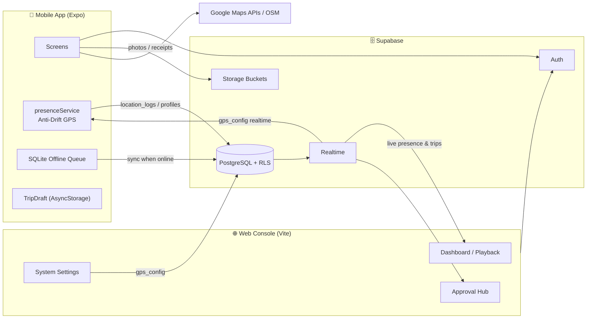
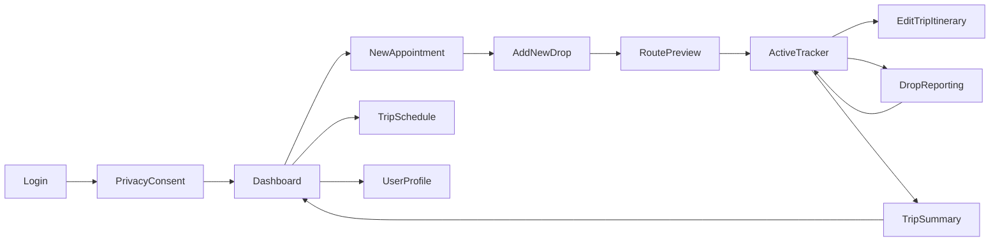
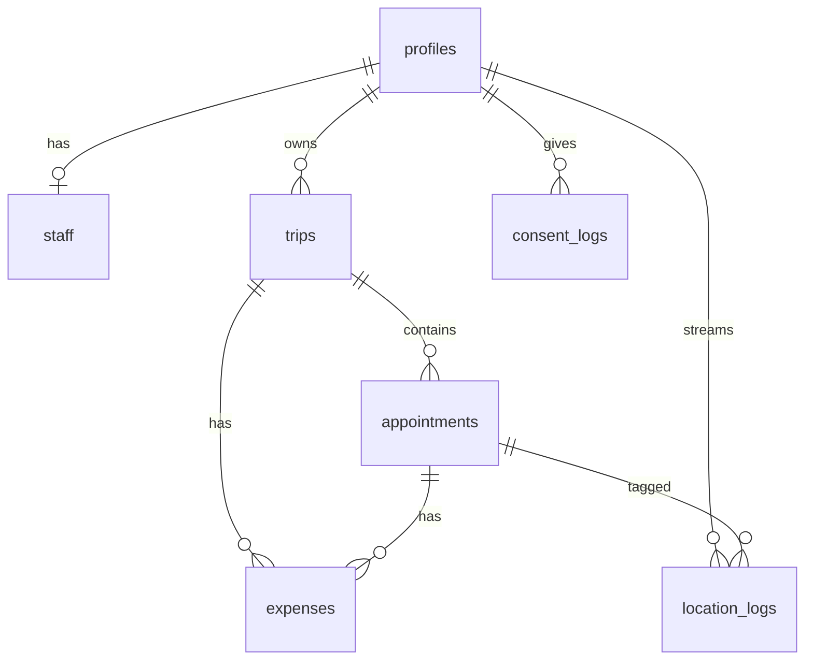
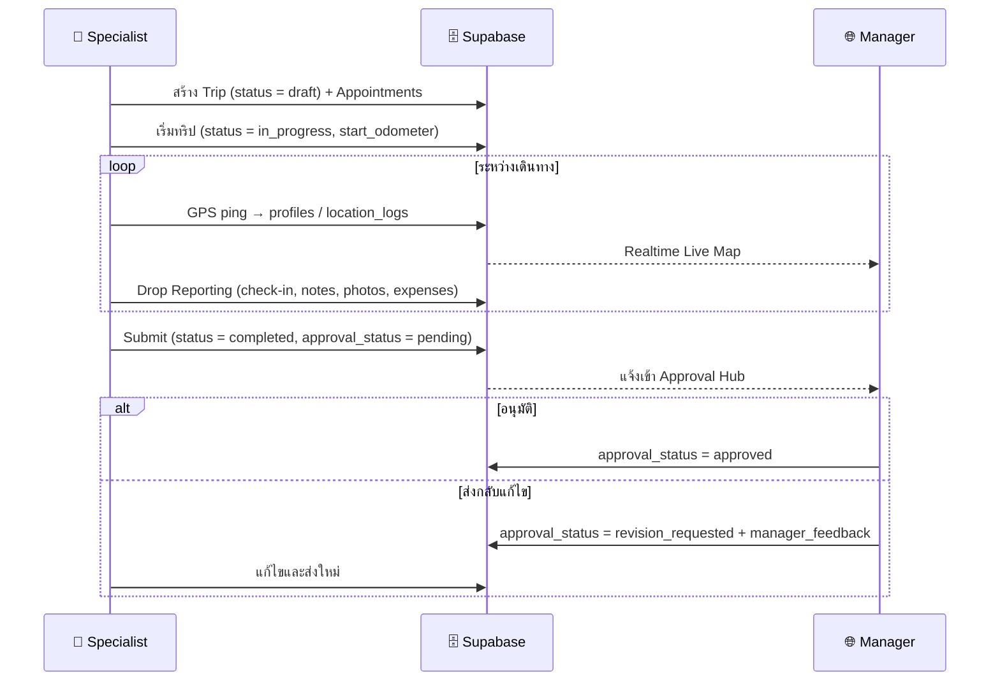

# 🚀 FastFleet — Field Marketing & Fleet Telemetry Platform

> ระบบบริหารทีมการตลาดภาคสนามและติดตามยานพาหนะแบบเรียลไทม์ ประกอบด้วย **Web Management Console** สำหรับผู้จัดการ/แอดมิน, **Mobile App** สำหรับพนักงานภาคสนาม (Field Specialist) และ **Supabase** เป็น Backend (PostgreSQL, Auth, Realtime, Storage)


---

## 📑 สารบัญ

1. [ภาพรวมระบบ](#-ภาพรวมระบบ)
2. [ฟีเจอร์หลัก](#-ฟีเจอร์หลัก)
3. [Tech Stack](#️-tech-stack)
4. [สถาปัตยกรรม](#️-สถาปัตยกรรม)
5. [โครงสร้างโปรเจค](#-โครงสร้างโปรเจค)
6. [Web Management Console](#-web-management-console-appsweb)
7. [Mobile Field Specialist App](#-mobile-field-specialist-app-appsmobile)
8. [ฐานข้อมูล Supabase](#️-ฐานข้อมูล-supabase)
9. [Business Flow: Trip Lifecycle](#-business-flow-trip-lifecycle)
10. [Core Engines](#️-core-engines)
11. [การติดตั้งและเริ่มใช้งาน](#-การติดตั้งและเริ่มใช้งาน)
12. [Environment Variables](#-environment-variables)
13. [คำสั่งที่ใช้บ่อย](#-คำสั่งที่ใช้บ่อย)
14. [การทดสอบ (Testing)](#-การทดสอบ-testing)
15. [ความปลอดภัย](#-ความปลอดภัย)
16. [Known Issues & Roadmap](#️-known-issues--roadmap)
17. [เอกสารเพิ่มเติม](#-เอกสารเพิ่มเติม)

---

## 🌐 ภาพรวมระบบ

FastFleet ออกแบบมาเพื่อองค์กรที่มีทีมการตลาด/ขายภาคสนาม ซึ่งต้องเดินทางพบลูกค้าหลายจุดต่อวัน โดยระบบจะช่วย:

- **พนักงานภาคสนาม** วางแผนทริป เพิ่มจุดแวะ (Drops) จัดลำดับเส้นทางอัตโนมัติ เช็คอินหน้างาน บันทึกเลขไมล์ ค่าใช้จ่าย ถ่ายรูปหลักฐาน แล้วส่งรายงานให้หัวหน้าอนุมัติ
- **ผู้จัดการ/แอดมิน** ติดตามตำแหน่ง GPS สดของทีม ดูเส้นทางย้อนหลัง ตรวจสอบ/อนุมัติทริปและค่าใช้จ่าย จัดการพนักงาน-ยานพาหนะ และดูรายงานวิเคราะห์

| ผู้ใช้งาน | แพลตฟอร์ม | Role ในระบบ |
|---|---|---|
| ผู้ดูแลระบบ / ผู้จัดการ | Web Console | `admin`, `manager` |
| พนักงานการตลาดภาคสนาม | Mobile App (+ Web แบบจำกัดสิทธิ์) | `specialist` |

---

## 🌟 ฟีเจอร์หลัก

### 🌐 Web Console
- 📍 **Live Operations Dashboard** — แผนที่ Leaflet แสดงตำแหน่ง ความเร็ว แบตเตอรี่ และสถานะ Online/Offline ของพนักงานแบบ Realtime
- 🛣️ **Route Playback** — เล่นเส้นทางย้อนหลังจาก `location_logs`
- 📅 **Schedule Calendar** — มุมมองปฏิทิน / การ์ดทริป / ตารางแจกแจง / สรุปผล พร้อม Export CSV
- ✅ **Visit History & Approval Hub** — ตรวจสอบรายละเอียดทริปรายจุด อนุมัติ หรือส่งกลับแก้ไข (Revision) พร้อม Feedback
- 👥 **Driver / Staff Management** — สร้างบัญชีพนักงาน จัดการแผนก ยานพาหนะ ใบขับขี่ และเปิด/ปิดการติดตาม GPS รายบุคคล
- 📊 **Reports & Analytics** — สรุประยะทาง ค่าใช้จ่าย ประสิทธิภาพ ตามช่วงเวลา พร้อม Export CSV
- ⚙️ **System Settings** — ตั้งค่าทั่วไป, GPS Anti-Drift Engine, นโยบายการอนุมัติ, API Key (Sync ไปยังแอปมือถือแบบ Realtime)
- 🔐 **Role-Based Access** — Specialist จะเห็นเฉพาะเมนูที่เกี่ยวข้องและข้อมูลของตนเอง

### 📱 Mobile App
- 🔑 Login + **Privacy & GPS Consent** (PDPA)
- 🗺️ สร้างทริปแบบ **Start Now** หรือ **Plan Later** พร้อมค้นหาสถานที่ผ่าน Google Places / OpenStreetMap
- 🧭 **Route Optimization** จัดลำดับจุดแวะอัตโนมัติ + แสดงเส้นทางถนนจริง (Google Directions)
- 📡 **Active Tracker** ติดตาม GPS ทั้ง Foreground และ Background พร้อม **Anti-Drift Engine**
- 📝 **Drop Reporting** — ยืนยันการเข้าพบ, เลขไมล์, บันทึกการประชุม, รูปถ่าย, ค่าใช้จ่าย + สลิป
- 📋 **Trip Summary** — 4-KPI Grid, รายงานรายจุด และส่งให้ผู้จัดการอนุมัติ
- 💾 **Trip Draft Persistence** (AsyncStorage) และ **Offline Queue** (SQLite)
- 🌙 Dark Mode และ 🌐 ภาษาไทย/อังกฤษ ครบทั้งแอป

---

## 🛠️ Tech Stack

| Layer | Technology |
|---|---|
| **Web Frontend** | React 19, Vite 8, TypeScript 6, Tailwind CSS 4, React Router 7, TanStack Query 5, Leaflet / React-Leaflet 5, Lucide Icons |
| **Mobile** | Expo SDK 57, React Native 0.86, React Navigation 7 (Native Stack), react-native-maps, react-native-maps-directions, Google Places Autocomplete |
| **Mobile Native Modules** | expo-location, expo-task-manager (Background GPS), expo-battery, expo-image-picker, expo-sqlite, AsyncStorage |
| **Backend** | Supabase — PostgreSQL (+ PostGIS, uuid-ossp), Auth, Realtime, Storage, RLS |
| **Maps / Geo** | Google Maps (Geocoding, Places, Directions), OpenStreetMap Nominatim (Fallback) |
| **Testing / Lint** | Vitest 4, Oxlint, Node E2E scripts |

---

## 🏗️ สถาปัตยกรรม



---

## 📂 โครงสร้างโปรเจค

```
fleet-manage/
├── apps/
│   ├── web/                              # 🌐 Web Management Console
│   │   ├── public/                       # favicon, icons
│   │   ├── scripts/
│   │   │   ├── e2e_test_bot.mjs          # E2E bot ทดสอบ Full-loop กับ Supabase จริง
│   │   │   └── physical_test_flow.mjs    # ทดสอบ Flow สร้างทริป → อนุมัติ แบบครบวงจร
│   │   ├── src/
│   │   │   ├── __tests__/                # Vitest unit / logic tests
│   │   │   ├── context/                  # LanguageContext (TH/EN), ThemeContext (Dark/Light)
│   │   │   ├── layouts/AdminLayout.tsx   # Sidebar, Auth Guard, Role-based Route Protection
│   │   │   ├── lib/                      # supabase client, database.types.ts
│   │   │   ├── pages/                    # หน้าหลักทั้งหมด (ดูตารางด้านล่าง)
│   │   │   ├── utils/                    # telemetryUtils (GPS/Odometer), dateUtils
│   │   │   ├── App.tsx                   # Routing
│   │   │   └── main.tsx
│   │   ├── vite.config.ts                # Dev server :3000, manual chunks
│   │   └── .env.example
│   │
│   └── mobile/                           # 📱 Field Specialist Mobile App
│       ├── src/
│       │   ├── components/               # FloatingBottomNav, LocationPickerModal
│       │   ├── lib/
│       │   │   ├── presenceService.ts    # Background GPS + Anti-Drift Engine
│       │   │   ├── mapServices.ts        # Geocode, Places, Directions, Route Optimizer
│       │   │   ├── mapConfig.ts          # Map constants & geocode helper
│       │   │   ├── storageServices.ts    # Camera/Gallery picker + Supabase Storage upload
│       │   │   ├── db.ts                 # SQLite offline queue
│       │   │   ├── TripDraftContext.tsx  # Trip draft state + AsyncStorage persistence
│       │   │   ├── LanguageContext.tsx   # TH/EN translations, quick templates
│       │   │   ├── ThemeContext.tsx      # Dark/Light theme
│       │   │   ├── supabase.ts           # Typed Supabase client
│       │   │   └── database.types.ts
│       │   └── screens/                  # 12 หน้าจอ (ดูตารางด้านล่าง)
│       ├── App.tsx                       # Navigation stack & providers
│       ├── app.json                      # Expo config, permissions, plugins
│       └── .env.example
│
├── supabase/
│   └── schema_and_seed.sql               # Master schema, triggers, RLS, buckets, seed
├── docs/
│   └── MULTI_TENANT_SUPER_ADMIN_PLAN.md  # แผนยกระดับเป็น Multi-Tenant SaaS
├── .stitch/designs/                      # UI design mockups (HTML)
├── PROJECT_AUDIT_REPORT.md               # รายงาน Audit ระบบ
└── README.md
```

---

## 🌐 Web Management Console (`apps/web`)

### Routes

| Path | หน้า | Admin | Specialist |
|---|---|:---:|:---:|
| `/admin/login` | [AdminLogin](apps/web/src/pages/AdminLogin.tsx) — เข้าสู่ระบบ | ✅ | ✅ |
| `/admin/dashboard` | [Dashboard](apps/web/src/pages/Dashboard.tsx) — Live Map & Telemetry | ✅ | ✅ (เฉพาะตนเอง) |
| `/admin/playback` | [RoutePlayback](apps/web/src/pages/RoutePlayback.tsx) — เส้นทางย้อนหลัง | ✅ | ✅ (เฉพาะตนเอง) |
| `/admin/schedule` | [SpecialistScheduleCalendar](apps/web/src/pages/SpecialistScheduleCalendar.tsx) — ปฏิทินงาน | ✅ | ✅ |
| `/admin/history` | [VisitHistory](apps/web/src/pages/VisitHistory.tsx) — ประวัติ & อนุมัติ | ✅ | ✅ (ดูอย่างเดียว) |
| `/admin/drivers` | [DriverManagement](apps/web/src/pages/DriverManagement.tsx) — จัดการพนักงาน | ✅ | ❌ |
| `/admin/reports` | [ReportsAnalytics](apps/web/src/pages/ReportsAnalytics.tsx) — รายงาน | ✅ | ❌ |
| `/admin/settings` | [SystemSettings](apps/web/src/pages/SystemSettings.tsx) — ตั้งค่าระบบ | ✅ | ❌ |
| `/admin/profile` | [AdminProfile](apps/web/src/pages/AdminProfile.tsx) — โปรไฟล์ผู้ใช้ | ✅ | ✅ |

### Authentication & Authorization
- Login ผ่าน `supabase.auth.signInWithPassword()` แล้วดึง `role` จากตาราง `profiles`
- [AdminLayout](apps/web/src/layouts/AdminLayout.tsx) ทำหน้าที่ **Auth Guard** — ตรวจ session, verify role จาก DB, ฟัง `onAuthStateChange` และ redirect Specialist ออกจากหน้า admin-only
- `admin` และ `manager` ได้สิทธิ์ระดับผู้ดูแลเท่ากัน (ผ่าน DB function `is_admin()`)

### System Settings Tabs
| Tab | รายละเอียด |
|---|---|
| General | ชื่อบริษัท, Timezone, สกุลเงิน, ภาษา |
| GPS Engine | ค่า Anti-Drift (`mbSpeedMoving`, `mbDistMoving`, `mbSpeedStatic`, `mbStaticRadius`, `dropIgnoreData`) |
| Policies | กฎการอนุมัติ (บังคับยืนยันทุกจุด, บังคับแนบสลิป, เพดานค่าใช้จ่าย, บังคับเลขไมล์เริ่มต้น) |
| API | API Key สำหรับเชื่อมต่อระบบภายนอก |

---

## 📱 Mobile Field Specialist App (`apps/mobile`)

### Screen Flow



| # | Screen | หน้าที่ |
|---|---|---|
| M1 | [LoginScreen](apps/mobile/src/screens/LoginScreen.tsx) | เข้าสู่ระบบด้วย Supabase Auth |
| M2 | [PrivacyConsentScreen](apps/mobile/src/screens/PrivacyConsentScreen.tsx) | ยินยอมเก็บข้อมูลตำแหน่ง (PDPA) |
| M3 | [DashboardScreen](apps/mobile/src/screens/DashboardScreen.tsx) | หน้าหลัก สถานะทริปวันนี้ |
| M4 | [NewAppointmentScreen](apps/mobile/src/screens/NewAppointmentScreen.tsx) | สร้างทริป (Start Now / Plan Later) |
| M5 | [AddNewDropScreen](apps/mobile/src/screens/AddNewDropScreen.tsx) | เพิ่มจุดแวะจากแผนที่และรายละเอียดลูกค้า |
| M6 | [RoutePreviewScreen](apps/mobile/src/screens/RoutePreviewScreen.tsx) | แสดงเส้นทางที่ถูกจัดลำดับแล้ว |
| M7 | [ActiveTrackerScreen](apps/mobile/src/screens/ActiveTrackerScreen.tsx) | ติดตาม GPS ระหว่างเดินทาง |
| M8 | [EditTripItineraryScreen](apps/mobile/src/screens/EditTripItineraryScreen.tsx) | แก้ไขแผนระหว่างทริป (ล็อกจุดที่ยืนยันแล้ว) |
| M9 | [DropReportingScreen](apps/mobile/src/screens/DropReportingScreen.tsx) | ยืนยันการเข้าพบ, เลขไมล์, ค่าใช้จ่าย, รูปถ่าย |
| M10 | [TripSummaryScreen](apps/mobile/src/screens/TripSummaryScreen.tsx) | สรุป KPI และส่งอนุมัติ |
| — | [TripScheduleScreen](apps/mobile/src/screens/TripScheduleScreen.tsx) | ปฏิทินทริป |
| — | [UserProfileScreen](apps/mobile/src/screens/UserProfileScreen.tsx) | โปรไฟล์และออกจากระบบ |

### Permissions ที่ต้องใช้
- **Location**: When-In-Use, Always (Background), Foreground Service (Android)
- **Camera / Photo Library**: ถ่ายรูปยืนยันการเข้าพบและสลิป
- Android package: `com.gnot44.fastfleet`

---

## 🗄️ ฐานข้อมูล Supabase

Schema หลักอยู่ที่ [`supabase/schema_and_seed.sql`](supabase/schema_and_seed.sql) (Version 2.4)

### ตารางหลัก (9 ตาราง — เปิด RLS ทั้งหมด)

| ตาราง | คำอธิบาย |
|---|---|
| `departments` | แผนก |
| `profiles` | ข้อมูลผู้ใช้ (ผูกกับ `auth.users`) + Live Telemetry (`is_online`, `current_lat/lng`, `current_speed`, `battery_level`) + ยานพาหนะ/ใบขับขี่ + สวิตช์ติดตาม GPS |
| `staff` | ข้อมูลประสิทธิภาพพนักงาน (ทริปรวม, ระยะทาง, on-time rate, safety score) |
| `trips` | ทริป — `status` (`draft → in_progress → completed / cancelled`) และ `approval_status` (`pending / approved / revision_requested`) |
| `appointments` | จุดแวะ/นัดหมายลูกค้าในทริป (ลำดับ, พิกัด, check-in/out, เลขไมล์, บันทึก, รูปถ่าย) |
| `expenses` | ค่าใช้จ่าย (ทางด่วน, ที่จอดรถ, น้ำมัน, เลี้ยงรับรอง, อื่นๆ) + สลิป |
| `location_logs` | GPS Stream (lat/lng, speed, heading, accuracy, battery, mock-location flag) |
| `consent_logs` | ประวัติการให้ความยินยอม PDPA |
| `system_settings` | ค่าตั้งระบบ (`gps_config`, `approval_rules`, `operating_hours`, `notifications_config`, `map_defaults`) |

### ER Diagram (ย่อ)



### Functions & Triggers

| ชื่อ | ประเภท | หน้าที่ |
|---|---|---|
| `handle_updated_at()` | Trigger | อัปเดต `updated_at` อัตโนมัติ (profiles, trips, appointments) |
| `sync_trip_total_expenses()` | Trigger | คำนวณ `trips.total_expenses` ใหม่เมื่อ expenses เปลี่ยน |
| `update_specialist_presence(...)` | RPC (SECURITY DEFINER) | อัปเดตตำแหน่ง/สถานะใน `profiles` และบันทึก `location_logs` |
| `is_admin()` | Helper | ตรวจว่าผู้ใช้ปัจจุบันเป็น `admin` หรือ `manager` (ใช้ใน RLS) |

### Storage Buckets
| Bucket | ใช้สำหรับ |
|---|---|
| `trip_photos` | รูปยืนยันการเข้าพบลูกค้า |
| `expense_receipts` | สลิปค่าใช้จ่าย |
| `avatars` | รูปโปรไฟล์ |

### Realtime Publications
`location_logs`, `trips`, `appointments` (และ Web/Mobile subscribe `system_settings`, `departments` เพิ่มเติม)

---

## 🔄 Business Flow: Trip Lifecycle



---

## ⚙️ Core Engines

### 1. GPS Anti-Drift Engine — [presenceService.ts](apps/mobile/src/lib/presenceService.ts)
ตัวประเมิน 3 สถานะเพื่อกรองพิกัดกระโดด (GPS jitter) เมื่ออยู่กับที่หรืออยู่ในอาคาร:

| สถานะ | เงื่อนไข (ค่าเริ่มต้น) | Action |
|---|---|---|
| **Running** | ความเร็ว > `MB_SPEED_MOVING` และขยับ > `MB_DIST_MOVING` | `RECORD` บันทึกพิกัด |
| **Stopped** | ความเร็ว ≤ `MB_SPEED_STATIC` และอยู่ในรัศมี `MB_STATIC_RADIUS` | `STABILIZE` ยึดพิกัด Anchor |
| **Ignore** | Accuracy แย่กว่า `MAX_GPS_ACCURACY` หรือ noise | `DROP` ไม่บันทึก |

- ค่า config ถูก **sync จาก `system_settings.gps_config`** และอัปเดตแบบ Realtime เมื่อแอดมินแก้ไขบนเว็บ
- ทำงานทั้ง **Background Task** (`expo-task-manager`), Foreground Watcher และ Heartbeat (20 วินาที)
- ตรวจจับ **Mock Location** และเคารพสวิตช์ `is_tracking_enabled` / `user_tracking_enabled`

### 2. Route Optimizer — [mapServices.ts](apps/mobile/src/lib/mapServices.ts)
- คำนวณระยะด้วย **Haversine**
- ≤ 8 จุด: **Brute-force permutation** หาลำดับที่สั้นที่สุด
- \> 8 จุด: **Greedy Nearest Neighbor**
- ดึงเส้นทางถนนจริงจาก Google Directions และ decode polyline

### 3. Telemetry Utilities (Web) — [telemetryUtils.ts](apps/web/src/utils/telemetryUtils.ts)
คำนวณระยะทาง GPS รายจุด/รายทริป เปรียบเทียบกับเลขไมล์ (Odometer) และจัดรูปแบบตัวเลข

### 4. Offline Queue — [db.ts](apps/mobile/src/lib/db.ts)
เก็บ request ลง SQLite (`offline_queue`) เมื่อออฟไลน์ แล้ว `processQueue()` ส่งขึ้น Supabase เมื่อกลับมาออนไลน์ (retry สูงสุด 5 ครั้ง)

### 5. Trip Draft Persistence — [TripDraftContext.tsx](apps/mobile/src/lib/TripDraftContext.tsx)
บันทึกแบบร่างทริปลง AsyncStorage อัตโนมัติ (debounced) ป้องกันข้อมูลหายเมื่อแอปปิด/crash

---

## 🚀 การติดตั้งและเริ่มใช้งาน

### Prerequisites
- **Node.js** 20.19+ หรือ 22 LTS และ npm
- บัญชี **Supabase** (Cloud project)
- **Google Maps API Key** (เปิด Maps SDK, Places, Geocoding, Directions)
- สำหรับมือถือ: แอป **Expo Go** หรือ Android Studio / Xcode (สำหรับ Development Build)

### 1. Clone Repository
```bash
git clone <repository-url> fleet-manage
cd fleet-manage
```

### 2. ตั้งค่า Supabase
1. สร้างโปรเจคใหม่ใน [Supabase Dashboard](https://supabase.com/dashboard)
2. เปิด **SQL Editor** แล้วรันไฟล์ [`supabase/schema_and_seed.sql`](supabase/schema_and_seed.sql)
3. สร้างผู้ใช้ใน **Authentication → Users** แล้วเพิ่มแถวใน `profiles` (กำหนด `role` เป็น `admin` / `manager` / `specialist`)
4. คัดลอก **Project URL** และ **anon public key** จาก *Project Settings → API*

### 3. Web Console
```bash
cd apps/web
cp .env.example .env        # Windows PowerShell: Copy-Item .env.example .env
# แก้ไข VITE_SUPABASE_URL และ VITE_SUPABASE_ANON_KEY
npm install
npm run dev                 # เปิด http://127.0.0.1:3000
```

### 4. Mobile App
```bash
cd apps/mobile
cp .env.example .env
# แก้ไข EXPO_PUBLIC_SUPABASE_URL, EXPO_PUBLIC_SUPABASE_ANON_KEY, EXPO_PUBLIC_GOOGLE_MAPS_API_KEY
npm install
npx expo start              # สแกน QR ด้วย Expo Go
```

> [!TIP]
> ฟีเจอร์ **Background Location** ทำงานได้สมบูรณ์บน Development Build เท่านั้น ใช้ `npx expo run:android` หรือ `npx expo run:ios`
> หากทดสอบบนอุปกรณ์จริงต่างเครือข่าย ใช้ `npx expo start --tunnel` (มี `@expo/ngrok` ใน devDependencies แล้ว)

### บัญชีทดสอบ (Quick Demo บนหน้า Login)
| Role | Email | Password |
|---|---|---|
| Admin | `admin@fastfleet.io` | `FastFleet@2026` |
| Specialist | `somchai.r@marketing.com` | `Password123!` |

> [!NOTE]
> บัญชีเหล่านี้ต้องถูกสร้างใน Supabase Auth ของโปรเจคคุณก่อน — ปุ่ม Quick Demo เพียงกรอกข้อมูลให้เท่านั้น

---

## 🔑 Environment Variables

### `apps/web/.env`
| Variable | คำอธิบาย |
|---|---|
| `VITE_SUPABASE_URL` | Supabase Project URL |
| `VITE_SUPABASE_ANON_KEY` | Supabase anon (public) key |

### `apps/mobile/.env`
| Variable | คำอธิบาย |
|---|---|
| `EXPO_PUBLIC_SUPABASE_URL` | Supabase Project URL |
| `EXPO_PUBLIC_SUPABASE_ANON_KEY` | Supabase anon (public) key |
| `EXPO_PUBLIC_GOOGLE_MAPS_API_KEY` | Google Maps API Key (Places / Geocoding / Directions) |

> [!IMPORTANT]
> ห้ามใช้ `service_role` key ในฝั่ง client เด็ดขาด และไฟล์ `.env` ถูก ignore โดย `.gitignore` แล้ว — commit เฉพาะ `.env.example`

---

## 💻 คำสั่งที่ใช้บ่อย

### Web (`apps/web`)
| คำสั่ง | หน้าที่ |
|---|---|
| `npm run dev` | รัน Dev Server (port 3000) |
| `npm run build` | Type-check (`tsc -b`) + Production build |
| `npm run preview` | Preview production build |
| `npm run lint` | Lint ด้วย Oxlint |
| `npx vitest run` | รัน Unit tests |

### Mobile (`apps/mobile`)
| คำสั่ง | หน้าที่ |
|---|---|
| `npm start` | `expo start` |
| `npm run android` | เปิดบน Android |
| `npm run ios` | เปิดบน iOS |
| `npm run web` | เปิดบน Browser |

### Supabase
```bash
# Regenerate TypeScript types ให้ตรงกับ DB จริง
npx supabase gen types typescript --project-id <project-ref> > apps/web/src/lib/database.types.ts
cp apps/web/src/lib/database.types.ts apps/mobile/src/lib/database.types.ts
```

---

## 🧪 การทดสอบ (Testing)

### Unit / Logic Tests (Vitest) — `apps/web/src/__tests__/`
| ไฟล์ | ครอบคลุม |
|---|---|
| `tripStateLogic.test.ts` | เพิ่ม/แก้ไข/เรียงลำดับ Drop, ล็อกจุดที่ยืนยันแล้ว |
| `specialistRbac.test.ts` | เมนูตาม Role, Route guard, Data isolation, สิทธิ์อนุมัติ |
| `routeOptimizer.test.ts` | Haversine, การจัดลำดับจุดแวะ (≤8 และ >8 จุด) |
| `odometerLogic.test.ts` | คำนวณเลขไมล์และตรวจสอบความถูกต้อง |
| `dashboardData.test.ts` | Mapping ข้อมูลพนักงานบน Dashboard |
| `e2eUserFlow.test.ts` | Flow ผู้ใช้จริงครบวงจร (Draft → Submit → Approve) |

```bash
cd apps/web
npx vitest run
```

### Integration Scripts (เชื่อมต่อ Supabase จริง)
```bash
cd apps/web
node scripts/e2e_test_bot.mjs        # Full-loop: Mobile + Supabase + Web logic
node scripts/physical_test_flow.mjs  # สร้างทริป → Check-in → Submit → Revision → Approve
```

> [!WARNING]
> สคริปต์เหล่านี้จะ **สร้าง/แก้ไขข้อมูลจริง** ในฐานข้อมูล ควรรันกับโปรเจค Staging เท่านั้น

---

## 🔒 ความปลอดภัย

- ✅ **Row Level Security** เปิดใช้ทุกตาราง — Specialist เข้าถึงได้เฉพาะข้อมูลของตนเอง, Admin/Manager เข้าถึงทั้งหมด
- ✅ **Auth Guard** บน Web ตรวจ session และ verify role จากฐานข้อมูลทุกครั้ง
- ✅ รหัสผ่านจัดการโดย Supabase Auth (bcrypt)
- ✅ `.env`, keys, certificates ถูก ignore ใน Git
- ✅ บันทึกความยินยอม PDPA ใน `consent_logs`

---

## ⚠️ Known Issues & Roadmap

### สรุปสถานะการแก้ไขประเด็น Known Issues (Resolved ✅)
| ระดับ | ประเด็น | สถานะ | การแก้ไข |
|---|---|:---:|---|
| 🔴 | Google Maps API Key ถูก hardcode | ✅ แก้ไขแล้ว | ย้ายไป `app.config.ts` อ่านค่าผ่าน `EXPO_PUBLIC_GOOGLE_MAPS_API_KEY` และลบออกจาก `app.json` |
| 🔴 | Supabase URL / Key ในสคริปต์ทดสอบ | ✅ แก้ไขแล้ว | ปรับ `e2e_test_bot.mjs` และ `physical_test_flow.mjs` ให้อ่านจาก `process.env` พร้อมคำสั่ง `npm run test:e2e` และ `test:flow` |
| 🔴 | Storage policies และ Upload path security | ✅ แก้ไขแล้ว | ปรับ Client upload ให้อยู่ภายใต้ `{userId}/...` และสร้าง SQL migration ป้องกัน Anon write จำกัดเฉพาะ Owner/Admin |
| ⚠️ | Data type `tenant_id` ไม่ตรงกับ DB จริง | ✅ แก้ไขแล้ว | ปรับ `schema_and_seed.sql` ให้เป็น `UUID` ตรงตาม DB จริงทั้งหมด |
| ⚠️ | Type Safety และการใช้ `as any` ในโค้ด | ✅ แก้ไขแล้ว | เคลียร์ `as any` ใน `presenceService.ts`, `db.ts` และเพิ่ม `GpsConfigPayload` interface (Type check 0 error) |
| 💡 | Realtime Subscriptions reload ถี่เกินไป | ✅ แก้ไขแล้ว | ติดตั้ง 500ms Debounce ใน `Dashboard`, `Calendar`, `Reports` และ `VisitHistory` ช่วยลด Load และ UI Thrashing |
| 💡 | แยกสิทธิ์ `manager` ออกจาก `admin` | ✅ แก้ไขแล้ว | รองรับบทบาท `manager` ใน `AdminLayout` / `AdminLogin` ให้ดูข้อมูลทีมและอนุมัติทริปได้ แต่จำกัดการเข้าถึง `System Settings` |

### Roadmap
- [ ] **Multi-Tenant SaaS + Super Admin** — ตาราง `tenants`, Tenant Switcher, RLS แยกบริษัท ([แผนงาน](docs/MULTI_TENANT_SUPER_ADMIN_PLAN.md))
- [ ] หน้าแจ้งเตือน Revision Feedback บนมือถือ
- [ ] Push Notifications (ทริปถูกอนุมัติ/ส่งกลับ, แบตเตอรี่ต่ำ)
- [x] Migration files แบบ versioned (`supabase/migrations/`) แทนไฟล์ schema เดียว
- [x] Test Suite & Verification Script (`npm test`, `npm run test:e2e`, `npm run test:flow`)
- [ ] CI pipeline (lint + test + build)

---

## 📚 เอกสารเพิ่มเติม

| เอกสาร | รายละเอียด |
|---|---|
| [PROJECT_AUDIT_REPORT.md](PROJECT_AUDIT_REPORT.md) | รายงานตรวจสอบระบบ (Schema, Security, Process Flow) |
| [docs/MULTI_TENANT_SUPER_ADMIN_PLAN.md](docs/MULTI_TENANT_SUPER_ADMIN_PLAN.md) | แผนสถาปัตยกรรม Multi-Tenant และ Super Admin |
| [supabase/schema_and_seed.sql](supabase/schema_and_seed.sql) | Database schema, triggers, RLS, buckets |
| [.stitch/designs/](.stitch/designs/) | UI Design mockups (Dashboard, History, Staff, Reports, Settings, Profile, Login) |

---

<p align="center">Built with ❤️ for Field Marketing Teams — <b>FastFleet</b></p>
